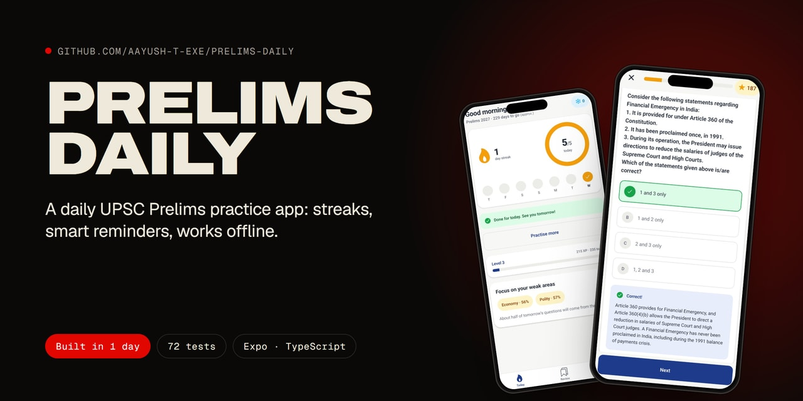
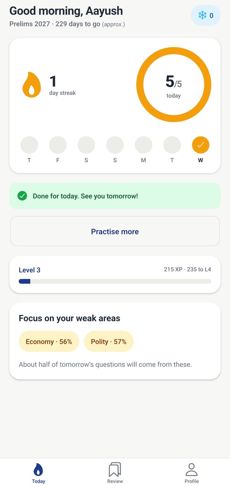
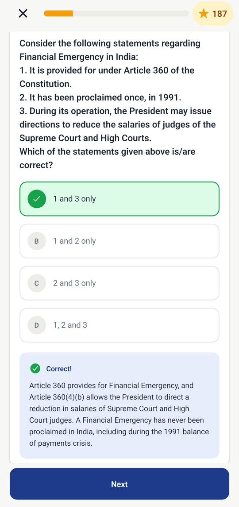
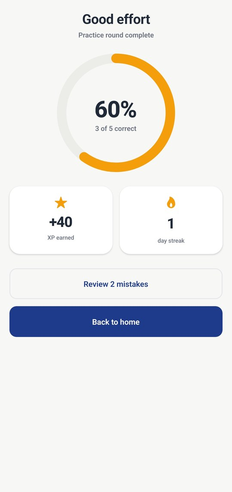
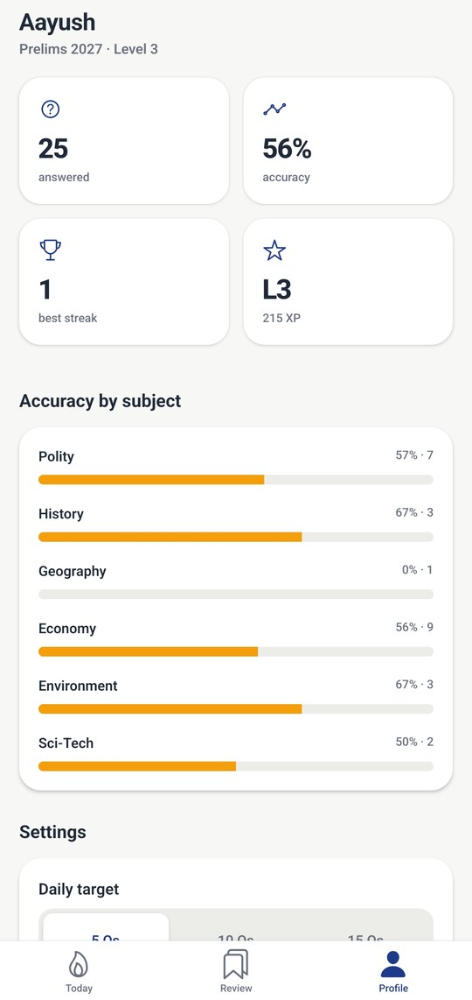
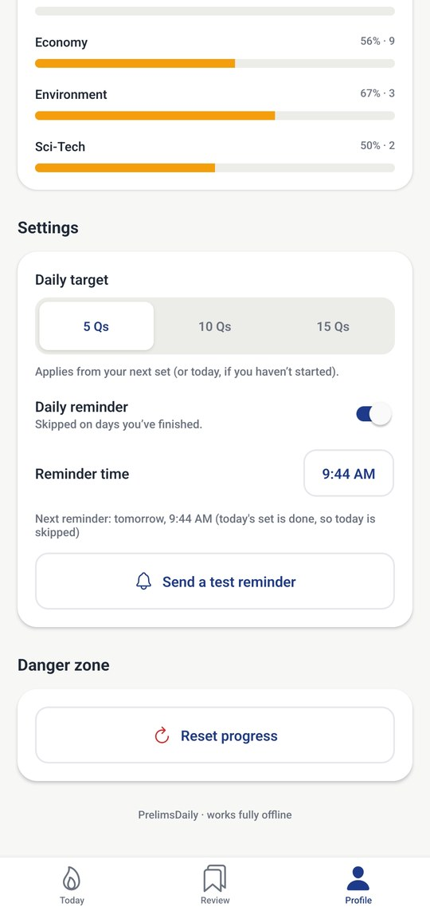

# PrelimsDaily

**A 10-minute daily habit for UPSC Prelims: one focused question set a day, with streaks, a daily target ring, XP, and reminders that adapt to your streak.**

Most aspirants don't fail for lack of material. They fail for lack of consistency. PrelimsDaily makes practice small, daily and rewarding: open the app, finish today's set, keep the flame alive. It runs fully offline, in Expo Go, on Android, iOS and web.

Built by **[Aayush Thakur](https://aayushthakur.vercel.app)** · [Case study](https://aayushthakur.vercel.app/work/prelimsdaily)

## Built in one day

I built PrelimsDaily in a single day as part of a startup application, from an empty repo to a tested app. To make that work, the rules (streaks, freezes, XP, the daily set) are pure functions with **72 unit tests**, the saved state has a versioned schema that falls back safely when something is malformed, and every trade-off is written down below.

## Try it

- **Android APK:** [download and install](https://expo.dev/artifacts/eas/ZyqMtbGDqKRKjswQCIaNNWd2-bsEVJWet3HekorOpg0.apk). Allow "install unknown apps" when asked.
- **Run from source in Expo Go (SDK 57):** `npm install && npx expo start`, then scan the QR code.

## Screenshots

<table>
  <tr>
    <td align="center" width="33%"><br><sub><b>Today</b>: streak, target ring, weak areas</sub></td>
    <td align="center" width="33%"><br><sub><b>Quiz</b>: instant feedback and explanation</sub></td>
    <td align="center" width="33%"><br><sub><b>Result</b>: score ring, XP, streak</sub></td>
  </tr>
  <tr>
    <td align="center" width="33%"><br><sub><b>Profile</b>: accuracy by subject</sub></td>
    <td align="center" width="33%"><br><sub><b>Smart reminders</b>: skip days you've finished</sub></td>
    <td></td>
  </tr>
</table>

## Features

- **Daily set:** a fixed set of MCQs per day (5 / 10 / 15), the same set all day, with weak subjects weighted in.
- **Streaks with freezes:** a freeze is earned every 7 days (max 2) and covers exactly one missed day.
- **Daily target ring:** animated progress toward today's set, with a week-dots strip of done and frozen days.
- **XP and levels:** XP for attempts, correct answers and completing the set (with a streak bonus). Square-root level curve.
- **Quiz flow:** instant right/wrong feedback, explanations, haptics, bookmarks. A results screen with count-up stats and confetti when you extend your streak or score at least 70%.
- **Practise more:** extra rounds after the daily set, never repeating questions already served today.
- **Review:** Mistakes and Bookmarks, filterable by subject. A mistake clears once you get it right.
- **Smart local reminders:** at the time you choose. Skips today once you're done. Copy changes with your streak and how far you got.
- **Onboarding:** name, target year, daily target and reminder time, with the notification prompt shown in context.
- **Profile:** accuracy, best streak, level, per-subject stats, settings and an in-app reset confirm.
- **Question bank:** 60 curated questions across Polity, History, Geography, Economy, Environment & Ecology, and Science & Technology.

## Tech stack

| Area | Choice |
| --- | --- |
| Framework | Expo SDK 57, React Native 0.86, React 19.2, React Compiler on |
| Language | TypeScript (strict) |
| Navigation | Expo Router (typed routes, `Stack.Protected`, tabs) |
| State | Zustand 5 + `persist` on AsyncStorage |
| Animation | Reanimated 4 (+ worklets), react-native-svg |
| Notifications | expo-notifications (local only) |
| Testing | Jest via `jest-expo` |
| Styling | `StyleSheet` + design tokens in `src/theme.ts` |

## Architecture

```
src/logic       Pure functions, no React, no I/O. Fully unit-tested.
    |            (date, streak, xp, dailySet)
src/store       Zustand store with persist: versioned schema, sanitize() on load.
    |            The only place state changes. Calls into logic/.
src/components  Dumb UI: props in, callbacks out (ProgressRing, StreakFlame, LevelBar...).
    |
src/app         Expo Router screens: read from the store, compose components.
```

- **Rules live in `logic/`.** Streak transitions, XP, level curve and daily-set selection are pure functions, so they're tested without rendering anything.
- **The store is the only writer.** Screens call actions such as `answer()`, `completeSet()` and `startPracticeRound()`. Derived values like the live streak are computed and never stored.
- **Persistence is defensive.** State is saved under a schema `version`. On load, `sanitize()` validates the shape and drops unknown question ids. Anything malformed falls back to defaults instead of crashing. `migrate()` is the hook for future schema bumps.
- `src/notifications.ts` wraps every notification call (each one guarded for web), and `src/store/hooks.ts` re-syncs reminders whenever the relevant state changes.

## Key decisions and trade-offs

| Decision | Why | Trade-off |
| --- | --- | --- |
| **AsyncStorage over MMKV** | MMKV needs native code and a dev build. AsyncStorage runs in Expo Go, so anyone can scan and run. | Async and slower. Fine for one small JSON blob. The splash stays up until hydration so there's no flicker. |
| **Local notifications as one-off `DATE` triggers for the next 7 days** | A repeating daily trigger can't skip today once the set is done, and can't vary its copy. Re-scheduling 7 single reminders on every relevant change makes both possible. | The app must be opened at least once a week to top the queue up. Works offline, needs no server. |
| **Reanimated on the UI thread, animating transforms** | The ring fill uses `useAnimatedProps` and the XP bar animates `scaleX`, not `width`. That avoids layout passes and JS-thread work, so it stays at 60fps. | Slightly more setup than plain `Animated` or layout animation (e.g. the bar's transform origin). |
| **`Stack.Protected` onboarding gate** | Routes are declaratively unavailable until a profile exists. No redirect effects, and no back-swipe into onboarding. | Ties the gate to Expo Router's API, which is an acceptable lock-in here. |
| **Root `ErrorBoundary`** | A render crash shows a friendly Retry screen, never a white screen. Progress is already persisted. | Catches render errors only. Async work is guarded at the call site (e.g. notifications never throw). |
| **Local dates, never UTC** | Days are `YYYY-MM-DD` from the device's local calendar. With UTC, an IST user practising before 5:30 AM would land on "yesterday" and could break their streak. | All day math goes through small helpers (`daysBetween`, `addDays`), and those are tested across month, year and leap-year boundaries. |
| **Seeded, deterministic daily set** | The set is seeded by the local date (FNV-1a hash → mulberry32 PRNG). It's identical all day, even after a reinstall. About half the picks come from the 2 weakest subjects (min. 3 attempts each), and questions seen in the last 3 days are avoided. | With a small bank, repeats eventually come back, by design and in a predictable order. |
| **No home-screen widget (yet)** | Widgets need native targets and a dev build, which conflicts with "runs in Expo Go". | It's the top item in Next steps. |

## Testing

```bash
npx jest
```

5 suites, 72 tests, all passing. They cover local-date math, streak transitions (continue, freeze, reset, earning freezes), XP and level curves, daily-set determinism, weak-subject weighting and recency rules, and loading saved state safely (garbage, stale question ids and partial sets fall back instead of crashing).

```bash
npm run typecheck   # tsc --noEmit
npm run lint        # expo lint
```

## Running locally

```bash
npm install
npx expo start
```

- **Phone:** scan the QR code with **Expo Go (SDK 57)**.
- **Web:** press `w` (or `npm run web`). Notifications and haptics are disabled on web, and everything else works.

## Building an APK (EAS)

```bash
npx eas-cli@latest build -p android --profile preview
```

The `preview` profile in `eas.json` produces an installable `.apk` for internal distribution. `production` builds an app bundle with an auto-incremented version code.

## Next steps

1. **Android home-screen widget:** today's ring and streak at a glance (needs a dev build).
2. **Supabase sync + leaderboard:** auth, cloud backup of progress, weekly streak/XP leaderboard among friends.
3. **AI explanations:** "explain differently" on any question, served through a rate-limited Supabase Edge Function so no API key ships in the app.
4. **Mains answer evaluation:** upload a written answer and get structured feedback on structure, content and keywords.
